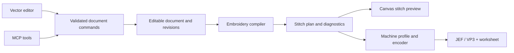
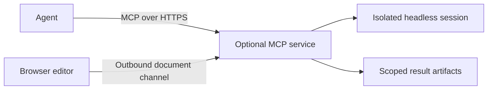

# Architecture proposal

Draft · updated 2026-10-05 · nothing in this document is implemented yet.

## One editor and one embroidery core

Proposed shell: React + TypeScript + Vite, following the inspected Pigma project. Keep the embroidery document, commands, compiler contract and serializers independent of React, the DOM, Tauri, and MCP transports.



Use SVG for editable vector geometry, selection and handles. Render large stitch streams in a separate Canvas2D layer, with a measured path to WebGL if needed. Do not create one DOM node per stitch. Design, Stitches and Preview are views of the same source, not independent documents.

## Userless, local-file workflow

No authentication, accounts, registration, profiles, user names, avatars, OAuth, API-key setup or login gates. This is a user requirement across the editor and MCP release surfaces, superseding the earlier auth proposal.

The primary document is a local file. Provide New, Open, Save and Save As, with the filename and unsaved-change state in the header. Browser Open uses an explicit file selection/drop; file handles and direct Save are optional platform capabilities, with file-input and download/Save As fallbacks. Desktop uses native file dialogs and filesystem access. Opening a file does not upload it or enroll it in a hosted workspace. IndexedDB recovery is a local crash-recovery copy, not evidence the source file was saved. Handle cancelled dialogs, unsupported files, lost write permission, external file changes and unsaved edits.

The HTML concepts demonstrate layout; actual local file decoding and persistence are not implemented yet.

## Source document and compiled output

Proposed `.welcome` format: a ZIP container with a versioned JSON manifest, editable document, local asset/font references or permitted embedded subsets, and an optional thumbnail. This is a new format proposal, not a compatibility promise. A schema version and migration policy precede shipping it.

The document records physical millimeters independently of zoom or CSS pixels. Use a declared coordinate convention (x right, y down for editor geometry) and explicit profile/export transforms for origin, axis direction, hoop position and format quantization. Keep higher precision while editing; quantize only at the encoder boundary.

| Entity | Responsibilities |
| --- | --- |
| Project | Schema, revision, name, units, engine/settings versions, assets, hoop/machine and fabric selection |
| Geometry objects | Stable IDs; path/primitive geometry; transforms; groups; visibility/lock; explicit sew-enabled state separate from display visibility |
| Embroidery operations | Geometry reference; running/satin/fill type; thread; stitch spacing/length; angle; underlay; compensation; entry/exit; tie/trim behavior |
| Satin geometry | Two rails, pairing/rungs, direction and split settings; not an ordinary wide outline stroke |
| Lettering | Unicode source text; font ID/version; glyph mapping; size/spacing/alignment; placement and embroidery overrides; editable source preserved |
| Sewing sequence | Ordered operation IDs and explicit commands; paint/layer order may seed it but does not silently replace it |
| Thread | Display color plus optional manufacturer, product number and weight; distinct from color-block identity |
| Machine profile | Supported formats/commands; hoops and stitchable bounds; placement; limits; mapping rules; verification status and manual reference |
| Compiled stitch plan | Typed commands, coordinates, thread blocks, source-object ranges, bounds, stats, diagnostics, source revision/hash and compiler version |

Compilation: normalize transforms → resolve lettering and geometry → validate paths/rails → generate underlay/top stitching → route between operations → apply command policies → validate → encode for the selected profile → validate emitted coordinates/metadata. Keep routing deterministic and do not reorder overlapping objects merely to reduce thread changes. An optimization proposal should be previewable and undoable.

Compiler results carry a source revision. Discard stale worker responses. Parameter edits mark previews stale; export waits for compilation of the current revision. Diagnostics include source IDs, severity, reason, and a meaningful suggested correction.

An imported stitch file, if supported later, is a stitch-level object. It does not recover original vectors, text, densities, or underlay intent. SVG import similarly reports any lost semantics; it does not imply complete Ink/Stitch SVG compatibility.

## Automated validation contract

Development and validation assume zero humans in the loop. Use a pinned native Ink/Stitch/pystitch reference to verify browser/headless generation and file encoding, and public fixture files to cover different producers and versions. No manual sewing, machine ownership, user-provided fixtures or manual Wilcom verification is a prerequisite. Report tested software parity, not physical machine certification.

Compare decoded commands/coordinates, order, thread metadata, bounds and declared format conversions. Preserve deterministic bytes where possible and explicitly account for volatile metadata. Use upstream tests for small synthetic edge cases alongside public cross-format samples. EMB needs its own automated version/object fidelity corpus because Ink/Stitch is not its reference reader.

## Browser engine decision

Ink/Stitch is not a browser SDK. Its current dependencies include inkex, wxPython, Shapely, NumPy and lxml. It now references `pystitch` for stitch-file handling. The plan separates digitizing algorithms, file codecs, and font assets. [Dependency source](https://github.com/inkstitch/inkstitch/blob/main/pyproject.toml).

| Route | Benefit | Cost / validation needed |
| --- | --- | --- |
| Extract selected Python core into a Pyodide Web Worker | Close to upstream algorithms; less early translation | Untangle GUI/Inkscape imports; prove required compiled dependencies; measure download, memory, startup, cancellation and Safari behavior |
| Selective TypeScript/WASM port | Smaller controllable runtime and easier headless sharing | Significant algorithm/geometry work; retain notices for derived code; automated fixture/reference comparison essential |
| Native Python/server-only engine | Useful development oracle | Cannot be the only production engine because it fails static-browser generation |

Recommended experiment: make the smallest running/satin/fill/lettering subset work through one compiler contract. Run a native upstream reference only in development, then compare browser results on fixed fixtures. Pyodide supports worker execution, but that does **not** establish that Ink/Stitch can run unmodified. [Pyodide worker documentation](https://pyodide.org/en/stable/usage/webworker.html).

Bundle the selected runtime, WASM, wheels and starter fonts with static releases. Lazy loading from the same origin is allowed; mandatory CDN/runtime downloads are not. Baseline compilation should not depend on cross-origin isolation headers. Cancellation can terminate/restart a worker if cooperative interruption is unavailable. Probe WASM MIME, worker paths, arbitrary base paths, offline caching and storage quota behavior.

For headless MCP, run the selected shared compiler under a compatible JS runtime/worker or WASM host, proving parity at Gate 1. Native Python must not become a divergent headless product by accident.

## Release surfaces

| Artifact | Editor | Compute/storage | MCP |
| --- | --- | --- | --- |
| Static web ZIP / hosted static assets | Same web bundle | Local worker; IndexedDB recovery; explicit file import/download | Can connect outward to optional online/self-host endpoint; static assets alone cannot serve remote MCP |
| macOS app / DMG | Same bundle in Tauri | Same compiler; native file save/open; bundled starter assets | Bundled service bound to loopback; optional stdio adapter; no system Node/Python prerequisite |
| Self-host OCI image | Serves same bundle | Browser processing by default; isolated headless jobs when requested | `/mcp`, anonymous document-session routing, optional configured storage, health and public capability config |
| Standalone MCP CLI | No UI required | Headless document session; explicit input/output files | stdio and optional loopback Streamable HTTP |
| Online MCP service | Static editor remains independently usable | Paired editor or ephemeral headless job; resource limits | HTTPS endpoint without login/auth; explicit anonymous document-session routing |

“Static” means deployable to an ordinary HTTP(S) static host, not necessarily that the eventual full editor runs from `file://`. The design concept itself does run from `file://`. A browser cannot listen as an MCP HTTP server. Online MCP requires compute somewhere; self-hosting that service is optional, and disabling it must leave the core workflow intact.

Pigma is a work in progress and serves as the reference for intended release options. Follow its shared build, deployment discovery and desktop cache/rollback direction. Recheck its evolving code when implementation begins; documentation/source differences are provisional observations, not settled Pigma architecture decisions. Welcome's desktop acceptance criteria include bundled runtime, port allocation, readiness, document-session routing, crash recovery, clean exit and packaged smoke tests. Room schema and collaboration relay are outside Welcome's scope.

Use immutable versioned releases and retain document backups before migrations. A signed desktop manifest should bind asset hashes, compiler/font versions and minimum shell/service versions. Hashes alone do not authenticate a manifest. Apply updates on a safe restart after saving; do not reload a dirty document in the middle of editing. First desktop release can ship signed app updates while separate asset updates pass validation.

## MCP design

Use the official MCP SDK with an explicitly pinned supported protocol revision and Streamable HTTP for remote/local service access; support stdio for CLI clients. Negotiate capabilities and test client interoperability. Protocol reference: [transports](https://modelcontextprotocol.io/specification/2025-11-25/basic/transports). This is a published version reviewed for this draft, not a claim about the newest future SDK. Do not add authentication flows to the userless product.

Two explicit session modes:

1. **Live editor:** the user enables a connection for the selected local document. The browser opens an outbound command channel to the same MCP service (for example WebSocket). Commands execute through the editor command layer and return results/preview artifacts. The editor remains authoritative. A closed or suspended tab yields an explicit unavailable response, with a timeout and no success claim.
2. **Headless:** the service/CLI owns an isolated document and uses the same command/compile interfaces. It can produce a downloadable `.welcome` plus machine files without a browser. Opening that project later is an explicit import; there is no implicit synchronization with another open document.



This command channel is still required for live online control. It is a single-session editor bridge, not a room/presence/collaboration system. If even that channel is undesired, online MCP can only offer headless generation and file handoff.

Proposed tool families (names are illustrative; exact JSON schemas come later):

| Tools | Contract |
| --- | --- |
| `document.create`, `document.inspect` | Create source document, inspect geometry/selection/sequence/revision and constraints |
| `machine.list`, `font.list`, `thread.list` | Discover supported profiles, verified status, font glyph/size ranges and bundled palettes |
| `document.apply` | Atomic typed operations: add paths, transforms, lettering, stitch parameters and sequence edits; `expectedRevision` plus `requestId` |
| `embroidery.compile`, `job.status`, `job.cancel` | Compile a named revision; return job/plan IDs, counts, source-linked diagnostics |
| `preview.render` | Vector/stitch preview and optional image resource of a named revision; useful for visual reasoning |
| `embroidery.validate`, `embroidery.export` | Validate/encode against a machine profile; export only matching compiled revision; machine file and worksheet as scoped resources |
| `document.save`, `document.undo` | Editable project artifact; undo one transaction, including a coherent agent edit |

Geometry tools accept numbers in mm and structured paths, not arbitrary executable code. Agent-created SVG must pass the same sanitized subset as human imports. Start with semantic tools, not generic shell/JavaScript execution.

Example agent flow: discover machine/font → create 80 mm badge document → add paths and editable lettering in one transaction → compile → inspect preview and diagnostics → revise using current revision → export JEF/VP3 for a verified profile → return machine artifact and editable source. Export does not start a physical machine.

Concurrent human/agent edits use optimistic revisions. A stale mutation returns a conflict with the current revision; no silent last-writer-wins overwrite. Idempotency keys prevent duplicate work on retries. All edits in a successful batch create one undo entry. Restrict undo to a known transaction/revision so an agent cannot undo unrelated user changes by mistake.

MCP connections identify a document session, not a person. Keep connection status, document selection, pause and disconnect visible without introducing login, bearer tokens, OAuth or credential setup. Anonymous session identifiers route commands; they are not accounts or an authentication guarantee. Connecting MCP is explicit and is the point at which the chosen document may be accessed through the service. Local file opening itself never connects or uploads.

Keep independent document sessions from accidentally mixing, reject commands after disconnect, validate Host/Origin on loopback HTTP, bound jobs/payloads, and expire temporary result artifacts. Finalize anonymous online routing during the MCP feasibility work; do not silently restore the superseded auth design. Online tool payloads may contain designs visible to the service while processing. Keep document bodies out of service logs. No persistent hosted project library is planned.

## Proposed package boundaries

```text
apps/web/                editor and browser integrations
apps/desktop/            Tauri shell, packaging, local service lifecycle
apps/service/            online/self-host HTTP, document sessions and jobs
packages/document/      schema, migrations, commands, undo and revision rules
packages/geometry/      paths, transforms, boolean operations and sampling
packages/embroidery/    compiler contract, runtime adapters, stitch plan
packages/formats/       project/SVG/machine encoding and validation
packages/fonts/         audited font manifests and converted assets
packages/mcp/           shared tool schemas/handlers, stdio and HTTP adapters
fixtures/               source designs, decoded plans and automated reference evidence
```

This layout is a proposal, not a request to scaffold every package before the feasibility result.
