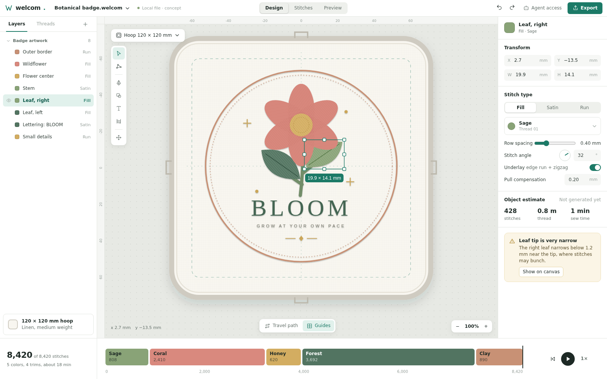

# Interface direction

Draft · updated 2026-10-05

The user-refined [`design/index2.html`](../design/index2.html) is the current visual reference. Open it directly in a browser; CSS and JavaScript are embedded. It is a design concept, not the application scaffold or an embroidery engine. The earlier `index.html` is retained as a previous exploration.

## Starting point for implementation agents

Use [the current screenshot](../design/workspace2.png) as the desktop visual target at 1600 × 1000. The editable reference is [index2.html](../design/index2.html). It is self-contained, with no build step or external dependencies. Do not base new work on the older screenshot or replace the user's cleaner layout with the first concept.

## Userless and local

No auth, accounts, sign-in, registration, profiles, user names or avatars. The top bar names the current local document. Production file actions are New, Open, Save and Save As, with machine Export separate. Open uses a device file chooser or drop; saved/unsaved status must reflect actual file operations. Browser recovery storage is not a saved source file. The current mockup labels its document state as a concept because it has no file decoder or persistence yet.

Preserve the workspace hierarchy, restrained colors, hoop-focused canvas, selected-object controls and sewing timeline when implementing the real editor. The mockup's sample counts, hatch textures, object measurements and playback are illustrative. Replace them with document/compiler results rather than treating them as algorithm fixtures. Read [PLAN.md](PLAN.md) and [ARCHITECTURE.md](ARCHITECTURE.md) for intended behavior and open decisions.

## Workspace

A warm gray working surface, white panels, dark readable text and a restrained teal accent. Thread colors belong primarily to the design. The hoop is a physical boundary on an otherwise spacious canvas. Units and measurements are millimeters; zoom never changes the design size.

- Top: local filename and file actions, save state, Design/Stitches/Preview views, agent connection and Export; no user identity controls.
- Left: Layers and Threads tabs. Object selection follows the canvas; the thread view shows color names and counts.
- Canvas: a floating tool rail, editable vector artwork, visible hoop, selection handles, stitch-direction guides and fit/zoom controls.
- Right: geometry first, then stitch type, thread, spacing/angle, underlay and compensation. The text object replaces generic geometry fields with lettering controls.
- Bottom: a sewing timeline with named thread blocks, playback and stitch position. Diagnostics link to the relevant object and stitch interval.

There is no separate giant digitizing dialog. Changing density or stitch direction should update a worker-generated preview while maintaining selection and showing when regeneration is pending.

## Three views of one project

| View | Purpose |
| --- | --- |
| Design | Edit shapes, nodes, satin rails and editable lettering. Stitch direction and entry/exit are visible for the selected operation. |
| Stitches | Inspect generated needle paths, underlay, jumps, trims and diagnostics. Geometry remains selectable through source mapping. |
| Preview | Judge composition with panels reduced; play actual sewing order and inspect boundaries. Thread simulation is an approximation, never a fabric-physics guarantee. |

The concept uses a small botanical badge and editable-looking “BLOOM” lettering to make these views concrete. Its hatch pattern is only an illustration of thread direction. Text uses system outlines for mockup purposes; no Ink/Stitch font has been bundled or digitized here.

## Demonstrated interactions

In `index2.html`, click view tabs, select objects in the canvas/sidebar, switch Layers/Threads, adjust the angle and spacing controls, toggle underlay/travel, and play/scrub the illustrative timeline. File actions, lettering editing, actual digitizing, export and agent connection are not implemented. Statistics and stitch textures are sample data, not validation results.

## Key detailed flows

**Lettering:** font choices should show stitched specimens, glyph coverage, suitable size ranges and license attribution. Keep source text editable. Unsupported glyphs and sizes appear next to the relevant controls; converting text to independent paths is an explicit action.

**Export:** show the selected machine model/profile and verification status, hoop and stitched bounds, file format, thread mapping and required conversion notes. Distinguish blockers from warnings. Save the editable project independently. Provide machine output plus a worksheet; never use “ready to sew” as a claim based only on an illustration.

**Agent connection:** show the current local document, connection status and disconnect action. No login or credential setup. The agent uses semantic editing tools and leaves undoable transactions. Agent operations need concise activity entries; no built-in chat/model provider is required. Do not show a working connection when the service is absent.

**Sequence:** keep sewing order explicit and separately inspectable from the objects hierarchy. Color sorting proposes a change and explains affected overlaps; it must not silently alter layering to improve a count.

## Interaction and accessibility rules

Target desktop browsers/tablets with a pointer first. At narrower widths collapse auxiliary panels and preserve the canvas; this is not a phone-first editing product. All toolbar buttons need text labels or accessible names and tooltips. Provide visible keyboard focus, Escape to close sheets, and keyboard equivalents for pointer operations. Never rely on thread color alone for identity: show names, numbers and sequence positions.

For production, honor reduced motion, use accessible contrast, keep input units explicit, and expose a navigable object list as a canvas alternative. Mockup layout is only the starting point; production keyboard/screen-reader operation needs its own acceptance checks.

## Required production states beyond the concept

Empty project, unsupported SVG report, missing font pack, first compiler load, compiling/cancelled/stale preview, invalid geometry, out-of-hoop blocker, no selected machine, failed export, autosave/quota failure, recovered project, agent disconnected/expired/stale mutation, offline mode and update available. Each state must explain the next useful action without exposing unnecessary implementation details.
